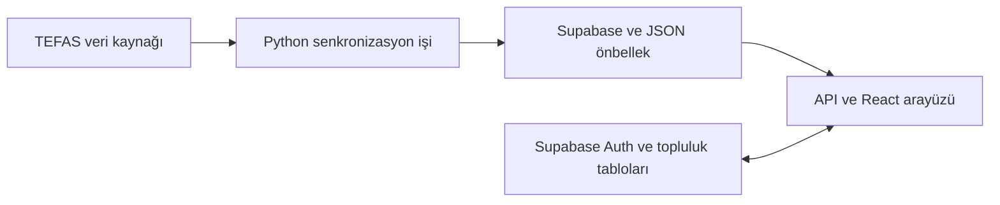

# FonSohbet


**TEFAS yatırım fonlarını incelemek ve fonlar üzerine fikir alışverişi yapmak için geliştirilen finans platformu.** React arayüzü; fon listeleri, fiyat geçmişi grafikleri, getiri göstergeleri ve yatırımcı tartışmalarını bir araya getirir.

## İşlevler

- Fon listesi, fon koduna göre detay sayfası ve dönem bazlı fiyat geçmişi.
- Ana sayfada piyasa/fon özeti ve Türkçe fiyat/getiri biçimlendirmesi.
- Forum, fon yorumları ve yanıtlar; kullanıcı profili ve Supabase kimlik doğrulaması.
- Fon bulma anketi ve yönetim ekranları.
- Python ile TEFAS veri çekimi, normalizasyon ve Supabase/yerel JSON önbellek senkronizasyonu.

## Mimari ve dosyalar



| Konum | Sorumluluk |
| --- | --- |
| [`src/pages/`](src/pages/) | Ana sayfa, fonlar, detay, forum, profil, anket ve yönetim ekranları |
| [`src/services/`](src/services/) | Fon/topluluk sorguları, yönetim ve piyasa yardımcıları |
| [`src/context/`](src/context/) | Kullanıcı oturumu ve fon verisi bağlamları |
| [`api/`](api/) | `/api/home/market-summary` ve `/api/funds/history` uçları |
| [`app/`](app/) | Python TEFAS istemcisi, hesaplama ve senkronizasyon katmanı |
| [`data/`](data/) | Fiyat önbelleği ve senkronizasyon kayıtları |
| [`.github/workflows/sync_funds.yml`](.github/workflows/sync_funds.yml) | Zamanlanmış veri güncelleme işi |

## Yerel geliştirme

Vite sürümünün desteklediği Node.js sürümüyle (kilit dosyası `^20.19.0 || >=22.12.0` gereksinimini belirtir) ve npm ile:

```sh
git clone https://github.com/Erkan54/fonsohbet.git
cd fonsohbet
npm ci
```

`.env.example` dosyasını `.env` olarak kopyalayıp kendi Supabase projenizin `VITE_SUPABASE_URL` ve `VITE_SUPABASE_ANON_KEY` alanlarını doldurun. Ardından:

```sh
npm run dev
```

`vite.config.js` yerel geliştirme sunucusunda iki `/api` yolunu karşılayan middleware içerir. `npm run build` üretim çıktısını `dist/` içine yazar; `npm run preview` yalnızca bu çıktıyı önizler ve Vercel sunucu işlevlerinin yerini tutmaz. `vercel.json` SPA yönlendirmelerini ve HTTP başlıklarını tanımlar.

## Veri senkronizasyonu

Python 3.10+ için `pip install -r requirements.txt` kullanın. Yazma işlemleri kendi test veritabanınızı günceller; sunucu ortamına `SUPABASE_URL` ve yetkili `SUPABASE_SERVICE_ROLE_KEY` verin. Service-role anahtarı tarayıcıya, `VITE_*` değişkenlerine veya README'ye konulmaz.

```sh
python -m app.jobs.sync_funds --days 35
# Daha uzun geçmişi tamamlamak için:
python -m app.jobs.sync_funds --backfill
```

Mevcut GitHub Actions işi Avrupa/İstanbul saatine göre 09:45 ve 19:45'te çalışacak şekilde tanımlanmıştır; gerçek çalışma zamanı GitHub kuyruğuna bağlıdır. Supabase tablo/politika kurulum SQL'leri bu GitHub sürümünde bulunmuyor; `funds`, `fund_prices`, `fund_sync_runs`, kullanıcı/topluluk tabloları ve kullanılan RPC'ler kodla uyumlu biçimde ayrıca hazırlanmalıdır.

## Kontrol komutları

```sh
npm run lint
npm run build
node --test src/services/__tests__/marketService.test.js
python -m unittest discover -s tests
```

Bunlar repoda bulunan kontrol araçlarıdır; yalnızca bu README güncellemesi kapsamında uygulama veya canlı veri servisleri yeniden çalıştırılmadı.

## Veri davranışı ve kapsam

Veriler açıklanmış fon fiyatları ve senkronizasyon tarihleri üzerinden sunulur; anlık borsa akışı değildir. Fon/topluluk servisleri bağlantı yokken veya bazı sorgular başarısız olduğunda `src/data/mockData.js` örneklerine dönebilir. API katmanı yerel fiyat önbelleğini kullanabilir; örnek/önbellek verisini güncel fiyat olarak yorumlamadan önce veri tarihini kontrol edin.

Platform bilgilendirme ve topluluk projesidir; yatırım işlemi gerçekleştirmez. Fon bulma ekranı profesyonel yatırım danışmanlığı olarak sunulmaz.

Geliştirici: [Ahmet Nurullah Erkan](https://github.com/Erkan54).
